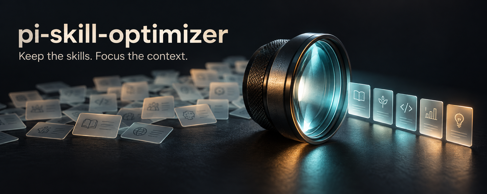
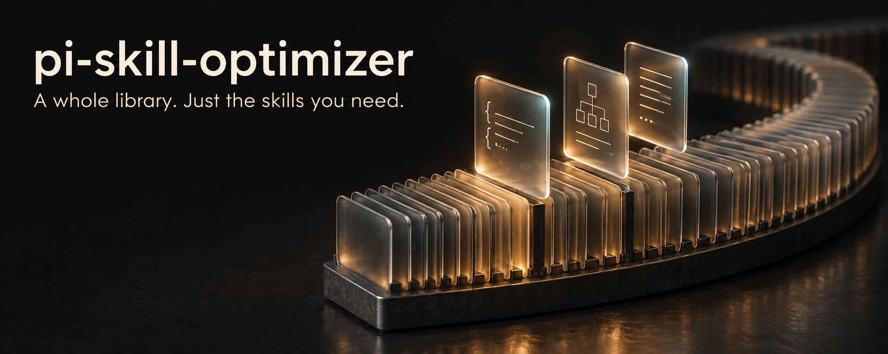

# Banner options

Original raster banners generated with the built-in image generation tool on 2026-09-28.
Option B was selected by the maintainer and copied to `../banner.png` for the README.
Option A is retained here as an alternative. Only the selected banner ships in the npm package.

## A: Focus

Prompt:

Create ONE finished premium open-source developer tool README banner, wide horizontal landscape aspect ratio approximately 2.5:1, for "pi-skill-optimizer". Option A concept: "Focus". A beautifully art-directed physical optical lens on a dark midnight tabletop, at right-center, luminous frosted glass and smoked translucent black metal, seen at a precise slightly elevated side angle. A broad subtle field of many small translucent paper-like skill cards enters from the left rear in soft focus, passing through the lens becomes a small, sharply focused constellation of 4-5 neatly spaced luminous cards at right. This is an artistic visual metaphor for narrowing attention while keeping the library intact, NOT a deletion shredder, NO literal computer UI, NO circuit brain, NO robot, NO funnel icon, NO flowchart, NO stock AI gradients, NO fireworks, NO arrows. Rich restrained cinematic lighting, warm ivory text, cyan glass caustics and a tiny amber accent, tactile materials, considered negative space, editorial sophistication. Typography in the left upper quadrant, large perfectly legible exact lowercase title "pi-skill-optimizer", underneath smaller exact line "Keep the skills. Focus the context." Title should be a clean refined grotesk, not futuristic stencil. Visual subject occupies primarily right 60%, left text has plenty breathing room on solid charcoal. Composition low clutter, generous 8% safe margins, works as GitHub banner. Render all typography accurately. No other text, no badges, no logos, no watermark. Opaque background.

## B: The living index

Prompt:

Create ONE finished beautiful wide horizontal GitHub README banner, approximately 2.5:1 landscape, for an open-source developer extension called "pi-skill-optimizer". Option B concept: "The living index". A dark, refined architectural artwork showing a sculptural arc of many thin frosted glass index cards neatly filed together like pages of a vast translucent library, curving away into darkness from the lower center to far right. Three selected cards hover just above their still-visible original slots, individually lit with warm amber and very subtle icy cyan edge light. On the cards, only minimal abstract etched marks suggesting compact code or structured knowledge, no legible tiny fake words, no charts. The collection remains intact. The image should feel like a beautifully photographed miniature impossible library or a high-end industrial design object, not a computer screenshot or a literal filing cabinet. Editorial, elegant and emotionally satisfying; incredibly tactile smoked glass, graphite ceramic base, volumetric restrained light, subtle soft reflections; huge quiet dark negative space in left 45%. Large perfectly legible title on left exact text "pi-skill-optimizer", line break after "pi-skill-" allowed only if needed but prefer one line in upper left. Subtitle exact text "A whole library. Just the skills you need." in smaller warm ivory grotesk type. Use thoughtful 8% safe margins. Background warm charcoal black, highlights ivory and amber, small cool accents, avoid neon overload. Distinct from a lens, no lens, no funnel, no arrows, no flowchart, no robot, no brain, no cyberpunk circuit board, no marketing badges, no watermark. Polished restrained cinematic visual with strong silhouette that reads at small banner size. Opaque background.
